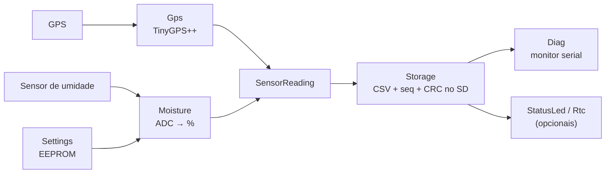

# moni-humid-leitos-rios

[](https://github.com/Alexandre200-lab/moni-humid-leitos-rios/actions/workflows/ci.yml)
[](https://github.com/Alexandre200-lab/moni-humid-leitos-rios/releases)
[](LICENSE)
[](https://www.arduino.cc/)
[](https://github.com/Alexandre200-lab/moni-humid-leitos-rios/actions/workflows/ci.yml)

**Monitoramento de umidade em leitos de rios com georreferenciamento GPS e registro em cartão SD.**

Sistema de baixo custo para campanhas de campo: um sensor capacitivo mede a umidade
do sedimento, um módulo GPS georreferencia cada leitura e um cartão microSD
armazena tudo em CSV com número de sequência e CRC-8 para verificação de integridade.
O firmware é modular, testado nativamente no CI e configurável em campo via serial.

## ✨ Funcionalidades

- Sensor **capacitivo** com alimentação chaveada (D7) para reduzir corrosão.
- Calibração e intervalo de amostragem **persistidos em EEPROM**, sem recompilar.
- Georreferenciamento via **TinyGPS++**, com data/hora formatadas com zeros à esquerda.
- CSV de 13 colunas com **`seq` monotônico e `crc8`** por linha.
- Recuperação automática do SD: se falhar no boot, tenta de novo a cada 10 s.
- Watchdog (`WDTO_8S`) e máquina de estados, com transições no monitor serial.
- Amostras de umidade **nunca são perdidas** por falta de GPS — `gps_valid` indica o que é válido.
- Recursos opcionais por *feature flags*: **RTC DS3231**, **LED de status** e **deep sleep**.
- Testes unitários da lógica pura + análise estática + checagem de links no CI.

## 🧠 Arquitetura



O `.ino` contém apenas a máquina de estados; cada responsabilidade vive em seu
par `.h/.cpp`. A lógica pura (`pure_logic.h`) é compartilhada entre o firmware e
os testes nativos. Detalhes em [docs/architecture.md](docs/architecture.md).

## 🔧 Hardware

| Componente | Função |
|---|---|
| Arduino Uno (ATmega328P) | Controlador |
| GPS Logger Shield v2.0 + módulo GPS | Posição e hora |
| Cartão microSD FAT32 | Armazenamento |
| Sensor capacitivo de umidade (SEN0193/v1.2) | Medição no leito |

Pinagem principal:

| Arduino | Destino |
|---|---|
| D2, D3 | GPS (UART software, 9600 baud) |
| D8 | CS do microSD |
| D11, D12, D13 | SPI (MOSI, MISO, SCK) |
| A0 | Saída analógica do sensor |
| D7 | VCC chaveado do sensor |
| D4, D6 | Opcionais: VCC do GPS, LED de status |

Diagrama, BOM e pinagem completa: [docs/hardware.md](docs/hardware.md).
Netlist para placa dedicada: [`hardware/netlist.csv`](hardware/netlist.csv).

## 🚀 Instalação

### Arduino IDE

1. Instale a [Arduino IDE 1.8+](https://www.arduino.cc/en/software) ou 2.x.
2. Instale a biblioteca **TinyGPS++** via `Sketch → Include Library → Manage Libraries`.
   A biblioteca **SD** já vem no core AVR da IDE; no CLI ela é instalada à parte.
3. Abra `firmware/moni_humid_leitos_rios/moni_humid_leitos_rios.ino`.
4. Selecione `Arduino Uno` e a porta correta.

### Arduino CLI

```bash
arduino-cli config init
arduino-cli core update-index
arduino-cli core install arduino:avr
arduino-cli lib install TinyGPSPlus SD RTClib

arduino-cli compile --profile uno --warnings all firmware/moni_humid_leitos_rios
arduino-cli upload --profile uno -p /dev/ttyACM0 firmware/moni_humid_leitos_rios
```

`sketch.yaml` fixa placa e versões das bibliotecas, garantindo o mesmo resultado
localmente e no CI. Compilação de referência (Arduino CLI 1.6):

```
Sketch uses 24522 bytes (76%) of program storage space.
Global variables use 1455 bytes (71%) of dynamic memory, leaving 593 bytes for locals.
```

## ⚙️ Configuração em campo

Abra o monitor serial a **9600 baud** e envie comandos terminados por Enter:

| Comando | Efeito |
|---|---|
| `SHOW` | Mostra calibração e intervalo atuais |
| `CAL_DRY=820` | Leitura bruta em solo seco |
| `CAL_WET=380` | Leitura bruta em solo saturado |
| `RATE=5000` | Intervalo entre amostras (1000..60000 ms) |
| `SAVE` | Grava na EEPROM |
| `RESET` | Restaura os padrões |

Procedimento completo: [docs/calibration.md](docs/calibration.md).
Parâmetros de compilação e *feature flags*: `firmware/.../config.h`.

## 📡 Uso

1. Insira o microSD formatado em FAT32 e ligue o conjunto.
2. Aguarde o fix GPS (pode levar alguns minutos na primeira vez).
3. Ao desligar, copie `gpslogNN.csv` e rode
   [`examples/analyze_log.ipynb`](examples/analyze_log.ipynb) para validar o CRC
   e plotar a umidade.

Saída típica:

```
moni-humid-leitos-rios v1.1.0
Comandos: SHOW, CAL_DRY=, CAL_WET=, RATE=, SAVE, RESET
Cartao SD inicializado.
Arquivo de log: gpslog00.csv
Umidade: 46.6
Sem fix GPS; linha gravada sem coordenadas.
```

Esquema das 13 colunas: [docs/data-format.md](docs/data-format.md).

## ✅ Qualidade

| Verificação | Onde |
|---|---|
| Compilação do firmware | `ci.yml` → job `build` |
| Testes da lógica pura | `tests/test_pure_logic.cpp` → job `unit-tests` |
| Análise estática | `cppcheck` → job `static-analysis` |
| Links da documentação | `scripts/check_links.py` → job `docs` |
| Documentação da API | `Doxyfile` → job `doxygen` (artefato `api-docs`) |
| Atualização de Actions | `.github/dependabot.yml` |
| Release com `.hex` | `.github/workflows/release.yml` (tags `v*`) |

Rodando localmente:

```bash
g++ -std=c++17 -Wall -Wextra -Werror tests/test_pure_logic.cpp -o /tmp/tests && /tmp/tests
python3 scripts/check_links.py
```

## 📁 Estrutura

```text
.
├── .github/
│   ├── ISSUE_TEMPLATE/            # bug, feature, campanha de campo
│   ├── workflows/ci.yml           # build + testes + lint + docs
│   ├── workflows/release.yml      # release com .hex
│   └── dependabot.yml
├── docs/
│   ├── adr/                       # decisões de arquitetura
│   ├── architecture.md
│   ├── calibration.md
│   ├── data-format.md
│   ├── field-checklist.md
│   ├── hardware.md
│   ├── telemetry.md
│   └── troubleshooting.md
├── examples/                      # notebook de análise + requirements
├── firmware/moni_humid_leitos_rios/
│   ├── moni_humid_leitos_rios.ino # entry point / máquina de estados
│   ├── config.h                   # pinos, constantes, feature flags
│   ├── types.h / pure_logic.h     # dados e lógica testável
│   ├── gps.* / moisture.* / storage.*
│   ├── settings.* / rtc.* / status_led.* / low_power.* / diag.*
│   └── sketch.yaml                # perfil arduino-cli
├── hardware/                      # netlist + diretrizes de PCB
├── scripts/check_links.py
├── tests/test_pure_logic.cpp
├── CITATION.cff / Doxyfile
├── CHANGELOG.md / SECURITY.md / CODEOWNERS
├── CONTRIBUTING.md / CODE_OF_CONDUCT.md
└── LICENSE                        # GPL-3.0
```

## 🗺️ Roadmap

- [x] Testes nativos, CI completo e release automatizado
- [x] EEPROM, CRC-8, watchdog e recuperação do SD
- [x] Notebook de análise e templates de issue/PR
- [ ] Validar em campo RTC, LED e sleep ([field-checklist.md](docs/field-checklist.md))
- [ ] Telemetria LoRa/Wi-Fi — contrato em [docs/telemetry.md](docs/telemetry.md)
- [ ] Esquemático KiCad e PCB a partir da netlist
- [ ] Dashboard web dos dados

## 🤝 Contribuindo

Leia [CONTRIBUTING.md](CONTRIBUTING.md) e o [Código de Conduta](CODE_OF_CONDUCT.md).

## 📄 Licença e citação

[GNU GPL v3.0](LICENSE) · © 2026 Alexandre Gouveia ·
[CITATION.cff](CITATION.cff) (botão "Cite this repository" no GitHub).
Histórico em [CHANGELOG.md](CHANGELOG.md) · segurança em [SECURITY.md](SECURITY.md) ·
mantenedor em [CODEOWNERS](CODEOWNERS).

## 🙏 Créditos

Baseado no exemplo *GPS Logger* da SparkFun e na biblioteca
[TinyGPS++](https://github.com/mikalhart/TinyGPSPlus) de Mikal Hart.
