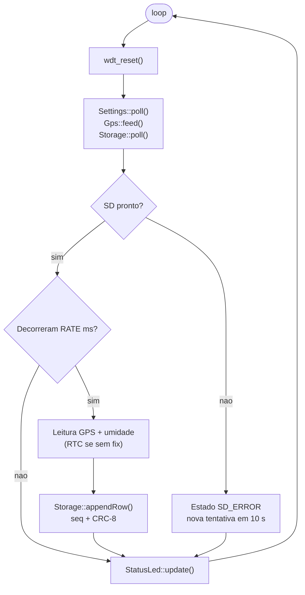

# Arquitetura do firmware

O sketch segue uma arquitetura em camadas: o `.ino` apenas orquestra, e cada
módulo encapsula uma responsabilidade.

## Modulos

| Modulo | Arquivos | Responsabilidade |
|---|---|---|
| `config` | `config.h` | Pinos, constantes e feature flags |
| `types` | `types.h` | Estruturas `GpsReading` e `SensorReading` |
| `pure` | `pure_logic.h` | Lógica pura e testável: umidade, datas, CSV, CRC-8 |
| `Diag` | `diag.h/.cpp` | Mensagens no monitor serial |
| `Gps` | `gps.h/.cpp` | `SoftwareSerial` + TinyGPS++ |
| `Moisture` | `moisture.h/.cpp` | Alimentação chaveada, ADC e conversão |
| `Storage` | `storage.h/.cpp` | SD, rotação de arquivos, CSV com seq e CRC |
| `Settings` | `settings.h/.cpp` | EEPROM e comandos seriais |
| `Rtc` | `rtc.h/.cpp` | DS3231 (feature flag) |
| `StatusLed` | `status_led.h/.cpp` | LED de status (feature flag) |
| `LowPower` | `low_power.h/.cpp` | Sleep + WDT (feature flag, experimental) |

`pure_logic.h` não inclui `Arduino.h` e não usa `printf` de ponto flutuante —
por isso o mesmo código roda no AVR e nos testes nativos do CI.

## Fluxo de execução

A presença ou ausência de fix **não impede** o registro da umidade: a coluna
`gps_valid` marca o que é válido. O SD é reinicializado automaticamente a cada
`SD_RETRY_MS` se falhar no boot.

## Decisões de projeto

- **Sem `String` dinâmica:** textos estáticos ou buffers fixos (2 KB de SRAM).
- **Buffer CSV estático de 104 bytes:** montado uma vez, gravado com um `println()`.
- **`millis()` por subtração:** tolera o estouro do contador após ~49 dias.
- **Watchdog:** `WDTO_8S` reinicia o sistema se o `loop()` travar.
- **Feature flags:** RTC, LED e sleep vêm desligados até validação em campo.
- **EEPROM:** calibração e intervalo sobrevivem ao reboot, sem recompilar.

Consulte os [ADRs](adr/) para o rationale das decisões de hardware e formato.
