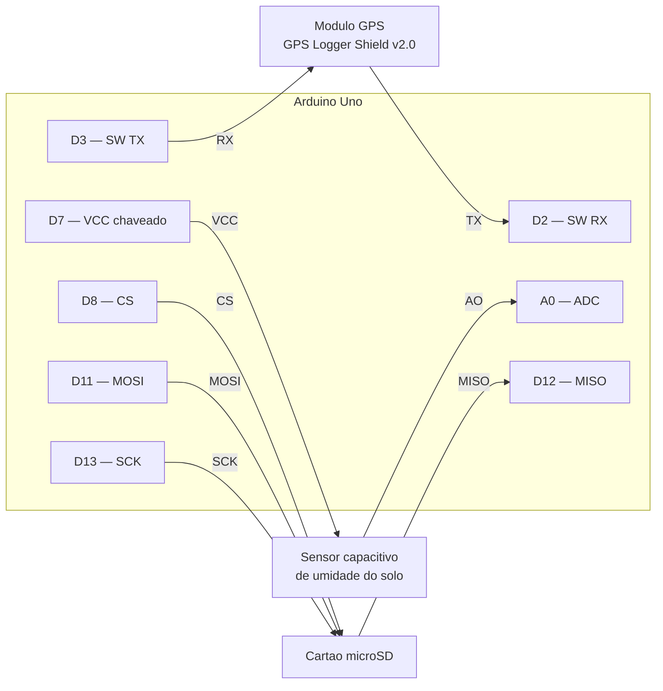

# Hardware e circuito

Esta pagina descreve os componentes, a pinagem e as conexoes do sistema.

## Componentes (BOM)

| Qtd. | Componente | Funcao | Observacoes |
|---:|---|---|---|
| 1 | Arduino Uno (ou compativel ATmega328P) | Controlador | 5 V lógicos |
| 1 | GPS Logger Shield v2.0 (Duinopeak/SparkFun) | GPS + soquete de microSD | Chave UART em **SW-UART** |
| 1 | Modulo GPS (no shield) | Posicao, hora e velocidade | 9600 baud |
| 1 | Cartao microSD (FAT16/FAT32, ate 32 GB) | Armazenamento CSV | Formatar antes do uso |
| 1 | Sensor capacitivo de umidade do solo (SEN0193 / v1.2) | Medida de umidade no leito | Saida analogica 0..3,3 V |
| 1 | Fonte 5 V + cabo USB | Alimentacao | Preferir fonte estabilizada em campo |

> Sensores **resistivos** (do tipo FC-28 com eletrodos expostos) corroem rapido em
> ambiente umido. Use um sensor **capacitivo** para leitos de rios.

## Pinagem

| Arduino Uno | Destino | Sinal | Detalhe |
|---|---|---|---|
| D2 | GPS | UART software (RX) | Pedido pelo `SoftwareSerial(2, 3)` do sketch original |
| D3 | GPS | UART software (TX) | Chave do shield em SW-UART |
| D8 | microSD | CS | Chip select |
| D11 | microSD | MOSI | SPI (fixo no Uno) |
| D12 | microSD | MISO | SPI (fixo no Uno) |
| D13 | microSD | SCK | SPI (fixo no Uno) |
| A0 | Sensor de umidade | AO | Entrada analogica |
| D7 | Sensor de umidade | VCC | Alimentacao chaveada pelo firmware |
| D4 | GPS (opcional) | VCC | GPS chaveado no modo de baixo consumo |
| D6 | LED (opcional) | Anodo | LED de status via resistor de 220 Ω |
| GND | GPS, SD, sensor | GND | Referencia comum |
| 5V | Shield e sensor | VCC | Alimentacao geral |

**Nota sobre D2/D3:** a ordem foi mantida exatamente como no sketch original para
nao alterar o comportamento do hardware. Se o modulo nao entregar sentencas NMEA,
inverta os dois pinos em `config.h` (`PIN_GPS_TX` / `PIN_GPS_RX`).

**Alimentacao chaveada do sensor:** o VCC do sensor e ligado apenas durante a leitura
(`Moisture::readRaw`). Isso reduz corrosao e consumo. Nao alimente o sensor
diretamente em 5 V se o modulo exigir 3,3 V — verifique a especificacao do seu modelo.

## Diagrama de conexoes

Alimentacao e GND comuns a todos os modulos nao foram desenhados para manter o
diagrama legivel. D4 (VCC do GPS) e D6 (LED) sao opcionais e so entram em uso
quando as feature flags correspondentes sao ativadas em `config.h`.

A netlist para uma futura placa dedicada esta em [`hardware/netlist.csv`](../hardware/netlist.csv).

## Montagem

1. Encaixe o GPS Logger Shield no Uno e posicione a chave em **SW-UART**.
2. Insira o microSD formatado em FAT32.
3. Conecte o sensor: `AO → A0`, `VCC → D7`, `GND → GND`.
4. Alimente o conjunto e abra o monitor serial a 9600 baud.
5. No primeiro boot o firmware cria `gpslog00.csv` e grava o cabecalho.
